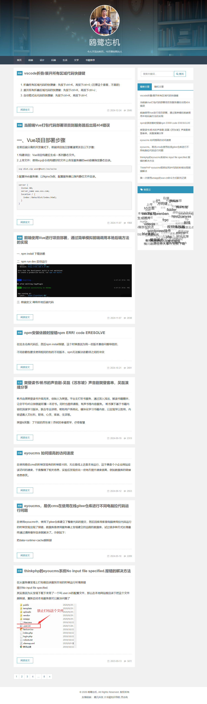
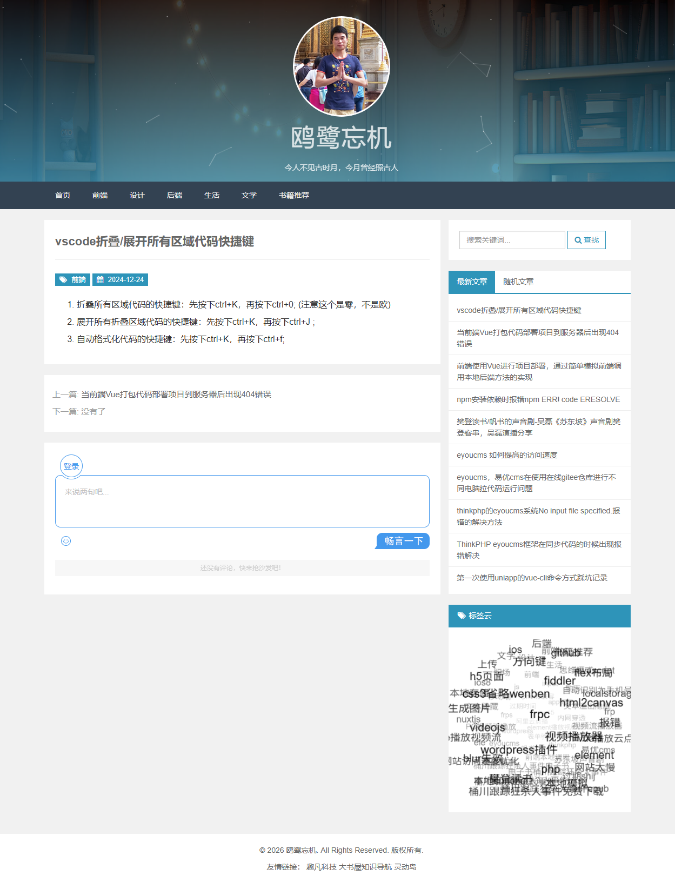
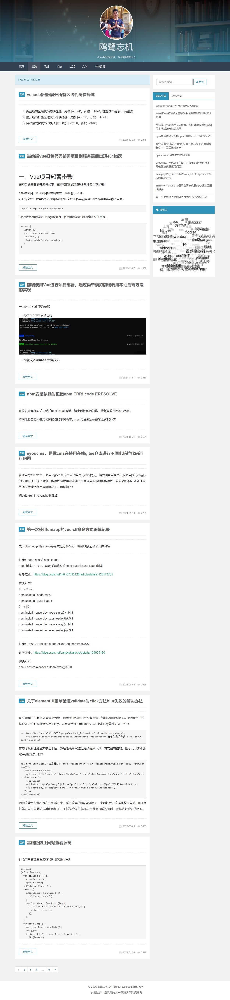

# PersonalBlog · 个人博客系统

一个前后端分离的个人博客系统，包含 **Web 前台 / 管理后台**、**Node.js API 服务** 和 **React Native 移动端**，支持文章发布、评论互动、游客账号、图片上传与后台管理。

- 线上地址：<https://dalanben.live/blog/>
- API 入口：`https://dalanben.live/ServiceRequest/api`

## 项目截图

| 首页 | 文章详情 |
| --- | --- |
|  |  |



## 功能特性

**访客**

- 浏览文章列表、分类、标签、归档
- 查看文章详情、评论、站点统计
- 按标题 / 内容搜索文章

**游客账号**

- 注册、登录（JWT + 图形验证码 + IP 限流）
- 发表评论、回复评论、点赞、收藏、关注博主
- 修改个人资料、上传头像
- 注销自己的账号（注销后评论会迁移到系统占位账号）

**管理员**

- 文章、分类、标签的增删改查
- 评论审核与管理
- 游客账号管理（禁言、删除）
- 菜单、站点设置、关于页、友情链接管理
- 富文本内容与图片上传（MinIO）

**安全与工程化**

- 登录密码使用 **SM2 国密**加密传输（C1C3C2），并带时间戳 + nonce 防重放
- JWT 双令牌：后台用户与游客使用独立密钥
- 接口白名单、验证码、IP 限流
- IP 属地解析（ip2region）
- MinIO 对象存储 + 孤儿文件定时清理
- Docker Compose 一键部署，Nginx 反向代理 + HTTPS

## 技术栈

| 模块 | 技术 |
| --- | --- |
| Web 前端 | React 19、Vite、Ant Design、Zustand、Axios、ECharts |
| 移动端 | React Native、Expo、Expo Router |
| 后端 | Node.js、Express、Sequelize |
| 数据库 | MySQL 8.0 |
| 对象存储 | MinIO |
| 部署 | Docker、Docker Compose、Nginx、Let's Encrypt |

## 目录结构

```text
PersonalBlog/
├── my-front/              # Web 前端（React + Vite）
│   ├── src/
│   │   ├── pages/         # 前台与后台页面
│   │   ├── components/    # 通用组件
│   │   ├── store/         # Zustand 状态
│   │   └── utils/         # 请求封装、常量、SM2 加密
│   ├── nginx.conf         # 生产环境 Nginx 配置
│   └── vite.config.js     # 开发代理（/ServiceRequest → 3002）
├── my-server/             # 后端 API（Express）
│   ├── src/
│   │   ├── config/        # 数据库、JWT、SM2、MinIO 配置
│   │   ├── controllers/   # 业务控制器
│   │   ├── models/        # Sequelize 模型
│   │   ├── routes/        # 路由
│   │   ├── services/      # MinIO 等服务
│   │   └── Uses/          # 鉴权、限流、验证码等中间件
│   ├── .env.example       # 环境变量模板
│   └── Dockerfile
├── my-front-app/          # 移动端（React Native + Expo）
├── doc/                   # 产品文档与截图
├── docker-compose.yml     # 前端 / 后端 / MySQL / MinIO
└── certbot/               # Let's Encrypt 证书（已忽略，不入库）
```

## 快速开始

### 1. 后端

```bash
cd my-server
npm install
cp .env.example .env      # 填写数据库、JWT、SM2、MinIO 配置
npm run dev               # http://localhost:3002
```

首次启动会自动创建数据库表（`DB.sync()`）并写入种子数据。

> 注意：`sync()` 只在表不存在时建表，**不会**给已有表补新字段。模型加字段后需要手动执行 `ALTER TABLE`，或引入迁移脚本。

### 2. Web 前端

```bash
cd my-front
npm install
npm run dev               # http://localhost:9318
```

开发环境通过 Vite 代理把 `/ServiceRequest` 转发到 `http://127.0.0.1:3002`，`/Preview` 转发到 MinIO `http://127.0.0.1:9000`。

生产构建：

```bash
npm run build             # 产物在 dist/，部署到 Nginx 的 /blog/
```

### 3. 移动端

```bash
cd my-front-app
npm install
cp .env.example .env      # 配置 API 地址
npm start                 # Expo 开发服务器
```

## 环境变量

后端所有敏感配置都通过环境变量注入，仓库中**不包含任何真实密钥**。

| 变量 | 说明 |
| --- | --- |
| `PORT` | 后端端口，默认 `3002` |
| `DB_HOST` / `DB_PORT` / `DB_NAME` | MySQL 连接信息 |
| `DB_USER` / `DB_PASSWORD` | MySQL 账号密码 |
| `JWT_SECRET` | 后台用户 JWT 密钥 |
| `JWT_TOURISTS_SECRET` | 游客 JWT 密钥（必须与后台不同） |
| `JWT_EXPIRES_IN` / `JWT_TEMP_EXPIRES_IN` | 令牌有效期 |
| `SM2_PRIVATE_KEY` / `SM2_PUBLIC_KEY` | SM2 密钥对，前后端必须一致 |
| `MINIO_ENDPOINT` / `MINIO_PORT` | MinIO 地址 |
| `MINIO_ACCESS_KEY` / `MINIO_SECRET_KEY` | MinIO 凭证 |
| `MINIO_BUCKET` | 图片存储桶 |
| `defaultPassword` | 初始化账号的默认密码 |

前端与移动端的配置见 `my-front/.env.development`、`my-front-app/.env.example`。

## Docker 部署

```bash
# 1. 准备后端环境变量
cp my-server/.env.example my-server/.env.docker
# 2. 在项目根目录准备 DB_PASSWORD（docker-compose 的 MySQL 初始化需要）
printf 'DB_PASSWORD=你的数据库密码\n' > .env
# 3. 启动
docker compose up -d --build
```

服务组成：

| 服务 | 说明 | 端口 |
| --- | --- | --- |
| `front` | Nginx，托管前端静态文件并反向代理 | 80 / 443 |
| `back` | Node.js API | 内部 3002 |
| `db` | MySQL 8.0 | 内部 3306 |
| `minio` | MinIO 对象存储 | 9001（控制台） |

HTTPS 证书放在 `certbot/certs/`，由 Nginx 挂载到 `/etc/nginx/certs`。证书目录已加入 `.gitignore`，**不要提交私钥**。

### 静态下载文件（PDF / APK）

大文件不要打进镜像，放在服务器数据盘，通过 Nginx 直接提供：

```bash
mkdir -p /data/blog-files/{pdf,apk}
scp -r ./files/* root@服务器IP:/data/blog-files/
```

然后在 `docker-compose.yml` 的 `front.volumes` 中挂载 `/data/blog-files`，并在 `nginx.conf` 增加对应的 `location /files/`。

## 数据库与模型说明

- 表名在 Linux 上**区分大小写**（`lower_case_table_names=0`），模型里的 `tableName` 必须与数据库完全一致。
- 生产环境不建议使用 `sync({ alter: true })`：它会重建表、重建外键和索引，数据量大时可能触发 MySQL 的 64 个索引上限。
- 修改模型字段后，请手动执行对应的 `ALTER TABLE`，或编写迁移文件按版本执行。

## 文档

- 产品规格：[doc/product-spec/Product-Spec.md](doc/product-spec/Product-Spec.md)
- 变更记录：[doc/product-spec/Product-Spec-CHANGELOG.md](doc/product-spec/Product-Spec-CHANGELOG.md)
- UI 设计提示词：[doc/ui/UI-Prompts.md](doc/ui/UI-Prompts.md)

## 安全说明

- 所有 `.env`、证书、密钥均已被 `.gitignore` 排除。
- 登录密码使用 SM2 加密传输，服务端解密后只保存业务所需数据。
- 生产环境请关闭全量 CORS，并配置 `trust proxy` 以正确获取真实客户端 IP。
- 上传接口限制 10MB，文件类型与对象名需由服务端校验。

## License

本项目仅用于个人学习与作品展示。如需商用，请自行评估依赖库许可证。
